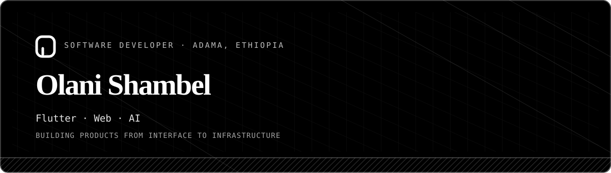

**Software developer · Flutter · Web · AI**

I build useful cross-platform products, from the first interface to the systems behind it.

[Portfolio](https://olani.dev) · [GitHub](https://github.com/olaanii) · [X](https://x.com/OlaaniiS) · [Telegram](https://t.me/c_O_d_e_r)

---

## Work

| Project | What it does | Built with |
| --- | --- | --- |
| [Veyra](https://github.com/olaanii/veyra) | Turns a project idea into architecture choices and practical implementation tasks. | TypeScript · AI |
| [Equb](https://github.com/olaanii/Equb) | Helps groups organize Ethiopian rotating savings contributions. | Flutter · Dart · Firebase |
| [FLUXX](https://github.com/olaanii/Fluxx---NFT-Minting-and-Marketplace) | NFT minting and marketplace prototype for the Sepolia testnet. | Next.js · Solidity · IPFS |
| [Afan Oromo Programming Language](https://github.com/olaanii/afan-oromo-PL) | A beginner-friendly language that translates Afan Oromo source into Python. | Python · Compiler tools |
| [BIRR](https://github.com/olaanii/birr) | A Go blockchain prototype with peer networking and JSON-RPC. | Go · Dart · Blockchain |

## Stack

| Area | Tools |
| --- | --- |
| Mobile | Flutter · Dart · Firebase |
| Web | React · Next.js · TypeScript · CSS |
| Backend | Node.js · Prisma · PostgreSQL |
| Languages | Python · Go · Solidity · Java |
| Tools | Git · Docker · Hardhat · IPFS |

## Focus

- Cross-platform apps that feel clear and work well on real devices
- AI-assisted product development through Veyra
- Language tools that make programming more accessible
- Practical experiments in Web3

## Activity

Explore my [interactive GitHub contribution graph](https://olani.dev/#activity) on my portfolio. The graph uses my public GitHub activity and supports drag-to-orbit in its 3D view.

---

*“Akkam” means “hello” in Afan Oromo.*

